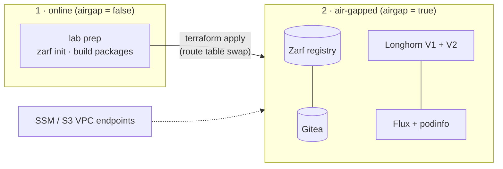

# Air-gapped Longhorn with Zarf

**Goal:** deploy, upgrade, take over and remove [Longhorn](https://longhorn.io) (V1 and V2 data engines) on a cluster
with **no internet access**, using [Zarf](https://zarf.dev) packages, and validate every step on a rebuildable AWS lab.

What it covers:

- Longhorn as one self-contained Zarf package per version: chart, all images, `longhornctl`, lifecycle hooks
  (`longhornctl install/check preflight`, readiness via `longhornctl diagnose`, V2 disk registration, safe uninstall).
- Install the latest **1.12.x**, upgrade to the latest **1.13.x**.
- Taking over an existing plain-Helm install with Zarf, then upgrading it.
- A GitOps app (Flux + podinfo) served from Zarf's in-cluster Gitea and registry, with its data on Longhorn.

## Contents

- [How it works](#how-it-works)
- [Provision](#provision)
- [Validate (headless)](#validate-headless)
- [Try it (interactive)](#try-it-interactive)
- [Reference](#reference)
  - [Package flow](#package-flow-packageslonghorn)
  - [Plain-Helm path (s3)](#plain-helm-path-s3)
  - [GitOps demo](#gitops-demo)
  - [Disks](#disks)
  - [Findings](#findings)
- [License](#license)

## How it works



One EC2 node (Ubuntu 24.04, `m6i.xlarge`, two extra EBS disks) runs single-node K3s installed by `zarf init`.

1. **Online phase.** The node bootstraps with internet access. `lab prep` initializes Zarf, pins the versions, builds the
   Longhorn 1.12.x and 1.13.x packages and the GitOps demo package, and stages the Helm chart and `longhornctl` for the
   takeover scenario.
2. **Cut the cord.** `airgap = true` swaps the subnet to a route table with no internet route and tightens the security
   group. Only the SSM and S3 VPC endpoints stay reachable, so you can still manage the node. `lab airgap-check` proves it.
3. **Air-gapped phase.** Every install, upgrade, takeover and removal runs from the local packages. Images come from the
   Zarf registry, git from Gitea; the Zarf agent rewrites references at admission.

**Why one node.** A real site builds packages on a connected machine and carries them across the gap. Here, the same node
plays both roles at different times, so there is no separate builder or transfer step. The cut is real: no internet route.

**What S3 is for.** The bucket carries the lab's source files (`scripts/`, `packages/` definitions, `tests/`), not built
packages. EC2 user-data is too small for them. After the cut, `lab sync` pulls edited files over the S3 VPC endpoint, so
script changes apply immediately. A changed package definition (hooks, values, versions) needs a rebuild, which needs the
internet: reconnect, `lab prep`, cut again.

**Assumption, not part of the solution:** host OS packages (`open-iscsi`, `nfs-common`, `cryptsetup`) come from the site's own
apt mirror. The lab installs them during the online phase. Offline, `longhornctl install preflight` still runs `apt update`;
it only warns (about 40 s of timeouts), and the packages are already installed.

```
terraform/             VPC, node, VPC endpoints, S3 bucket for lab files; `airgap` toggles internet access
  user-data.sh.tftpl   host packages -> disks -> zarf -> lab files -> `lab prep`
packages/longhorn/     Zarf package: longhorn-preflight -> longhorn-diagnose (optional) -> longhorn
packages/gitops-demo/  Zarf package: Flux v2.9.6 + podinfo 6.15.0 (repo mirrored to Gitea) + busybox for the V2 test
scripts/lab.sh         on-node driver (`lab <cmd>`)
scripts/ssm.sh         laptop helper (shell, logs, port-forwards)
tests/v2-workload.yaml V2 (SPDK) smoke StatefulSet
```

## Provision

Needs Terraform and AWS credentials (the default profile, or `profile` in tfvars). Interactive sessions and port-forwards
need the AWS `session-manager-plugin`. `scripts/ssm.sh` reads `terraform output`, or `terraform/terraform.tfstate` with
`jq` when the Terraform CLI isn't installed (e.g. Terraform run via Docker).

```bash
cd terraform
cp terraform.tfvars.example terraform.tfvars   # prefix (your handle), region, owner
terraform init && terraform apply              # online node; bootstrap + `lab prep` take ~10 min
../scripts/ssm.sh log                          # wait for "BOOTSTRAP DONE"

echo 'airgap = true' >> terraform.tfvars       # cut the cord
terraform apply
../scripts/ssm.sh lab airgap-check             # internet blocked, S3 reachable
```

Every AWS resource name starts with `prefix`. Resources are tagged `Owner`.
To change scripts or packages: `terraform apply` (uploads to S3), then `lab sync` on the node; this works while air-gapped.
To rebuild packages, reconnect (`airgap = false`), run `lab prep`, then cut again.
Rebuild the node from scratch with `terraform apply -replace=aws_instance.node` (with `airgap = false`).
`terraform destroy` removes everything.

## Validate (headless)

```bash
../scripts/ssm.sh lab all     # or on the node: sudo -i; lab all
```

Scenarios refuse to run unless the node is air-gapped (`LAB_ALLOW_ONLINE=true` overrides).

| | What | Checks |
|---|---|---|
| s1 | Zarf deploy Longhorn `LH_FROM` → GitOps demo → write data (V1 via podinfo, V2 via busybox) | preflight, diagnose, Flux pulls from Gitea |
| s2 | Zarf deploy `LH_TO` over it (Helm upgrade) | data survives restart (V1 + V2), diagnose |
| s3 | `mirror-resources` + plain `helm install` `LH_FROM` → demo → `zarf package deploy --take-ownership --force-conflicts` | takeover, engine images before/after, data, diagnose |
| s4 | upgrade the taken-over release to `LH_TO` (`--force-conflicts`) | same as s2 |
| s5 | remove demo → remove Longhorn | CRDs and namespace gone |

`lab all` = s1, s2, s5 (wipe disks), s3, s4, s5 (wipe disks). A run takes about 30 minutes.

Versions: `lab prep` resolves the latest stable 1.12.x and 1.13.x whose chart and `longhornctl` are published (today
1.12.1 → 1.13.0) and pins them in `/var/lib/lab/state/versions.env`, so nothing needs GitHub afterwards. Pin explicitly with
`LH_FROM=… LH_TO=… lab prep`. Longhorn upgrades one minor at a time; `preUpgradeChecker.upgradeVersionCheck` stays on.

## Try it (interactive)

`lab demo` walks through the s1 + s2 story. Each step prints a title, a short explanation and the command, then waits:
**Enter** runs it, **s** skips, **q** quits.

| # | Step | What you see |
|---|------|--------------|
| 1 | Proof of air gap | GitHub, Docker Hub, GHCR, chart repo blocked |
| 2 | Starting point | K3s node, `zarf package list`, registry/Gitea/agent pods |
| 3 | Package contents | components, files, deploy/remove hooks, image list |
| 4 | Install `LH_FROM` | preflight install/check, chart install, `diagnose` gate |
| 5 | Health check | `longhornctl diagnose` |
| 6 | GitOps deploy | Flux + podinfo from Gitea on a Longhorn PVC |
| 7 | GitOps wiring | git URL and image rewritten to in-cluster Gitea/registry |
| 8 | Write data | podinfo `/store` (V1) + V2 volume |
| 9 | Upgrade to `LH_TO` | same `zarf package deploy`, newer package |
| 10 | Engine images | old + new engine image, volume `currentImage` |
| 11 | Verify | restart podinfo, read data back (V1 + V2) |
| 12 | Final health | `longhornctl diagnose` |

See [docs/demo-transcript.md](docs/demo-transcript.md) for the full output of a real run.

From your laptop, in three terminals:

```bash
scripts/ssm.sh demo       # the walkthrough
scripts/ssm.sh ui         # Longhorn UI -> http://localhost:8080
scripts/ssm.sh podinfo    # podinfo     -> http://localhost:9898
```

If Longhorn is already installed, reset first: `LAB_FORCE_REMOVE=true LAB_WIPE_DISKS=true lab s5`. Rehearse without pauses
with `DEMO_AUTO=true lab demo`. Reset after each run with `LAB_WIPE_DISKS=true lab s5`. Show the Helm takeover separately
with `lab s3`.

## Reference

### Package flow (`packages/longhorn`)

1. **longhorn-preflight** installs the version-matched `longhornctl` and applies a ConfigMap so that Zarf creates
   `longhorn-system` (agent `mutate` + `private-registry` secret). Its `onDeploy.after` hooks:
   - `longhornctl install preflight --enable-spdk --huge-page-size 2048 --restart-kubelet` (restarts K3s; retried until the API is back)
   - wait for the API and for `hugepages-2Mi` to be allocatable
   - `longhornctl check preflight --enable-spdk`. This **always exits 0**, so the hook greps the per-node `error:` list.
   - label the node `node.longhorn.io/create-default-disk=config` and set `node.longhorn.io/default-disks-config` to the V1
     disk plus the V2 block disk `v2disk`. Longhorn uses this only when it first registers the node, so upgrades never change disks.
2. **longhorn-diagnose** (optional, default on): `longhornctl diagnose` ships in Longhorn 1.14 (longhorn/longhorn#3355).
   Until then, the lab uses a dev build (`longhornio/longhorn-cli:v1.14.0-dev-20261004`) only to check Longhorn health;
   `lab build` extracts the binary from the image. `lab build <ver> --no-diagnose` drops it.
3. **longhorn**: the upstream chart with `values-lab.yaml` (single-node replicas, V2 enabled, `global.imageRegistry`
   set to the Zarf registry, UI NodePort 30080) plus the `longhorn-v2` StorageClass, which becomes the default.
   Images come from the release's `longhorn-images.txt`. Hooks:
   - `onDeploy.after`: `longhornctl-diagnose diagnose` with retries (or Zarf waits), then patch `v2disk` into the Longhorn
     node if missing (needed after a takeover) and wait for it to be Ready.
   - `onRemove.before`: refuse while volumes exist (`LAB_FORCE_REMOVE=true` overrides), set `deleting-confirmation-flag`.
   - `onRemove.after`: restore `local-path` as default; optionally wipe disks (`LAB_WIPE_DISKS=true`). The preflight
     component deletes `longhorn-system`, which Zarf does not do itself.

### Plain-Helm path (s3)

Emulates a site that installed Longhorn with Helm from its own private registry: `zarf package mirror-resources --images`
pushes the images into the Zarf registry, the namespace gets a copy of Zarf's pull secret, and the stock chart (staged by
`lab prep`) is installed with `helm install` and `global.imageRegistry` set to the registry. The Zarf package uses the same
registry, so the takeover keeps every image reference (verified: the engine image is the same before and after).

### GitOps demo

`repos: https://github.com/stefanprodan/podinfo.git@6.15.0` is mirrored into Gitea when the package is deployed. The
`GitRepository` keeps the GitHub URL; the Zarf agent rewrites it at admission to
`http://zarf-gitea-http.zarf.svc.cluster.local:3000/zarf-git-user/podinfo-<crc32>.git` and adds `secretRef: private-git-server`.
The Flux `Kustomization` patches upstream `./kustomize`: HPA 1/1, emptyDir → Longhorn PVC, `fsGroup`, `Recreate` strategy.
`lab write` / `lab verify` use podinfo's `/store` API. `DEMO_SC=longhorn-v2 lab deploy-demo` puts podinfo on a V2 volume.

### Disks

| Device | Size (default) | Use |
|---|---|---|
| root | 80 GiB | K3s, Zarf registry + Gitea PVs (local-path), packages |
| EBS #1 | 100 GiB | ext4 at `/var/lib/longhorn` → Longhorn default V1 disk |
| EBS #2 | 120 GiB | raw → V2 block disk `v2disk` (`diskDriver: aio`) |

Disks are identified by size, so the sizes must differ. `V2_DISK_PATH` in `/etc/longhorn-lab.env` is the stable
`/dev/disk/by-id/nvme-Amazon_Elastic_Block_Store_vol...` link, because `/dev/nvmeXn1` names can swap after a reboot.

### Findings

- **`--force-conflicts` is required for the takeover.** Helm 4 installs with server-side apply under the `helm` field
  manager, so Zarf's SSA upgrade fails with field conflicts (and so does the automatic rollback). The `helm` manager still
  co-owns fields such as `helm.sh/chart` labels afterwards, so the next upgrade (s4) needs it too.
- **Longhorn needs `global.imageRegistry`; the agent's image rewrite alone is not enough.** The agent rewrites pod
  images (`…:v1.12.1` → `127.0.0.1:31999/…:v1.12.1-zarf-<crc>`) but not the `--manager-image` argument. The manager
  compares the two, treats itself as an old manager, and waits until it times out, over and over. Longhorn also creates
  engine and instance-manager images from settings, not from pod specs.
- **Takeover and instance managers.** If a takeover changes image references, Longhorn creates new instance managers;
  on a single node the new V2 one stays `stopped` while the old one serves an attached V2 volume. So s3 detaches the V2
  workload first, even though the references don't change here; `verify` scales it back.
- **The uninstall job can read a stale `deleting-confirmation-flag`.** It reads the flag through an informer (the
  apiserver watch cache). Right after the demo's Flux CRDs were deleted, the cache lagged and both job attempts saw
  `false`. The remove hook and `lab remove` now patch the flag and wait until a `?resourceVersion=0` read returns `true`.
- **Zarf bug: a failed chart uninstall leaves the package unremovable**
  ([zarf-dev/zarf#5491](https://github.com/zarf-dev/zarf/issues/5491)). In `remove.go`, `slices.DeleteFunc` runs on a
  shallow copy of the component, so the saved state gets an empty `{chartName: ""}` entry in place of the removed chart.
  Every retry then fails with `Release name is invalid`. Workaround: delete the empty entry from the
  `zarf-package-<name>` secret in the `zarf` namespace.
- **`examples/longhorn` in the Zarf repo** sets `csi.kubeletRootDir: /var/lib/rancher/k3s/agent/kubelet`. Current K3s uses
  `/var/lib/kubelet`, which Longhorn detects, so this lab leaves it unset. The example also disables `upgradeVersionCheck`.

## License

[Apache License 2.0](LICENSE)
